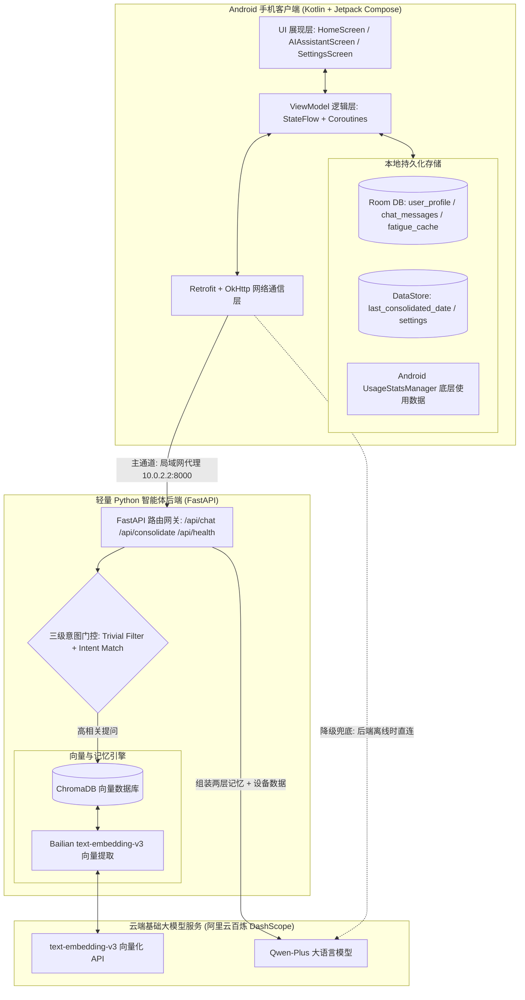
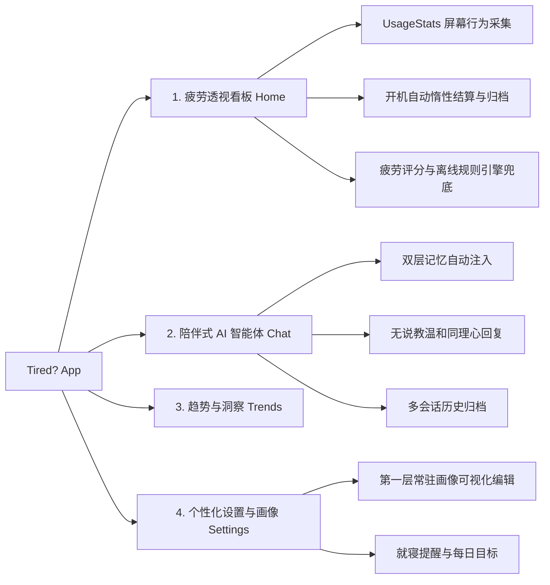
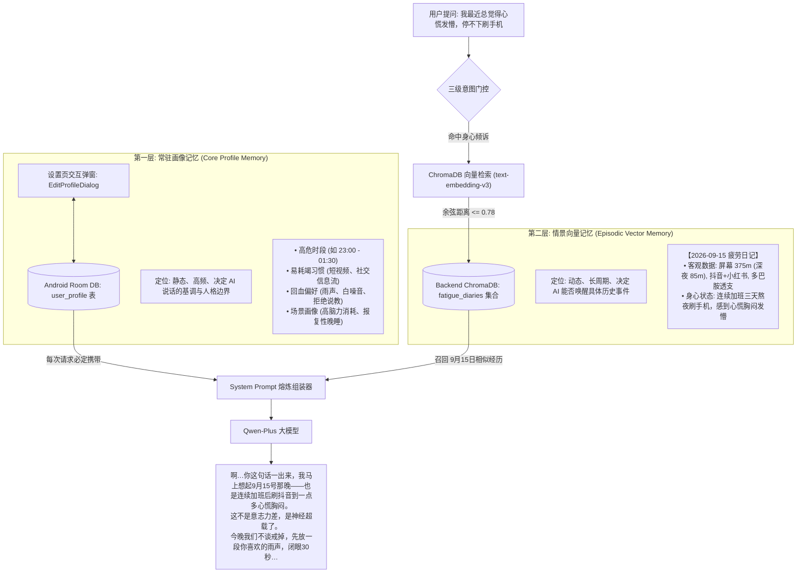

# 《Tired?》数字健康 Agent 技术架构与记忆系统规范

> **项目名称**：Tired? (数字疲劳与假休息解救 Agent)
> **文档版本**：v1.2 (里程碑归档)
> **核心定位**：从传统的“自律防沉迷/屏幕时间警察”重塑为懂你疲惫的“数字宿醉解救者与精力精算师”，专注于解决“明明是在玩手机，但是感觉很累”的现代人假性休息痛点。

---

## 一、 项目技术架构图解

项目采用 **“移动客户端（Android 原生） + 本地轻量智能体后端（Python FastAPI） + 云端大模型基础底座（阿里云百炼）”** 的端云协同架构。



### 1. 技术栈选型

- **移动端 (Android)**:
  - 架构模式：MVVM + 单向数据流 (UiState + StateFlow)
  - UI 框架：Jetpack Compose + Material 3 (现代声明式 UI)
  - 依赖注入：Hilt (Dagger)
  - 本地存储：Room SQLite (ORM) + Preferences DataStore
  - 网络请求：Retrofit 2 + OkHttp 3 + Kotlinx Serialization
- **后端服务 (Python Backend)**:
  - Web 框架：FastAPI + Uvicorn (高性能异步轻量服务)
  - 向量数据库：ChromaDB (本地持久化存储，无需独立搭建大型数据库)
  - 向量模型：阿里云百炼 `text-embedding-v3` (1024 维高精度中文向量)
- **大模型底座**:
  - 对话与诊断模型：阿里云百炼 `qwen-plus`
  - 协议标准：OpenAI Compatible API 规范

---

## 二、 核心功能模块设计



### 1. 疲劳透视看板 (Home)

- **行为数据采集**：通过 `UsageStatsDataSource` 调用系统底层 `UsageStatsManager`，获取今日前台各 App 运行秒数、启动次数、时段分布、夜间（22:00-06:00）使用量。
- **疲劳定性模型**：识别 5 种典型疲劳模式：
  - `DOPAMINE_OVERLOAD`（多巴胺透支：重度短视频/社交信息流）
  - `FRAGMENTED_ANXIETY`（碎片焦虑：高频跨应用切屏）
  - `SLEEP_PROCRASTINATION`（睡眠推迟：深夜报复性玩手机）
  - `INFO_OVERLOAD`（信息过载：高密度资讯长阅读）
  - `HEALTHY`（平衡健康）
- **本地降级保障**：`LocalRuleEngine` 提供纯本地离线算法，即使完全断网也能秒级给出疲劳指数与建议。

### 2. 陪伴式 AI 智能体对话 (AI Chat)

- **角色定位**：懂你疲惫的深夜休息搭档，拒绝“你缺乏自律”等大道理说教。
- **两层记忆动态融合**：每次提问自动关联你的**长期生活习惯**与**历史相似经历**。
- **双轨容灾**：优先走携带向量回忆的本地 Python 后端；若后端未开启，自动平滑降级直连云端 Qwen-Plus。

### 3. 个性化设置与画像编辑器 (Settings)

- **画像透明化**：将 AI 对你的第一层核心画像直接摆在界面上，用户拥有完全的知情权和修改权。
- **自定义配置**：支持修改易耗竭时段、常失控应用类型、喜爱的回血方式（如白噪音/深呼吸）。

---

## 三、 【重点】双层记忆机制深度剖析与决策复盘

我们在记忆机制上进行了深度的架构讨论与迭代，最终落地为**“端侧常驻画像 + 后端情景切片”**的双层体系。



---

### 1. 核心设计决策全复盘 (Why & How)

#### 决策一：为什么选 ChromaDB 而非 FAISS？

- **讨论背景**：在挑选向量数据库时，FAISS 和 ChromaDB 是两个主要候选。
- **最终决策**：**采用 ChromaDB。**
- **底层原因**：
  1. FAISS 是纯数学向量索引引擎，**它无法存储原始文本和属性元数据**。若用 FAISS，必须自行编写大量胶水代码维护另一套 SQLite 来映射向量 ID 与日记文本。
  2. ChromaDB 是专为 AI Agent 设计的现代化向量库，内部天然将 SQLite（存原文字与元数据）与 HNSW（存高维向量）封装为一体。
  3. ChromaDB 完美兼容自定义 Embedding 函数，仅需几行代码即可直接桥接阿里云百炼的 `text-embedding-v3` 模型。

#### 决策二：日记存储粒度——为什么坚决不采用“每聊一句话存一条向量”？

- **讨论背景**：用户每发一句话，要不要当成一条日记做向量化？
- **最终决策**：**以“自然日”为唯一主键（`diary_YYYY-MM-DD`），一天至多固化一条高密度综合切片。**
- **底层原因**：
  1. **避免垃圾噪音**：若每句话都存，库里会充斥海量“你好”、“好的”、“谢谢”，导致向量语义严重稀释，检索频频误触发。
  2. **避免白天数据冲突**：白天的屏幕时长是实时变化的（下午 2 小时，晚上变成 5 小时）。如果在白天频繁写库，会导致数据版本混乱和多次重复调用 Embedding 扣费。
  3. **数据主客观熔炼**：这一条日记由“盖棺定论的客观硬件数据”与“全天聊天的核心主观感受”熔铸而成，价值极高。

#### 决策三：“最后一秒未开 App 怎么办”——开机自动惰性结算 (Lazy Settlement)

- **讨论背景**：日结日记如果定在 23:59:59 触发，用户此时没开 App 就会漏掉。
- **最终决策**：**次日开机补算（惰性结算机制）。**
- **实现细节** ([HomeViewModel.kt](file:///c:/Users/Administrator/Desktop/TiredApp/app/src/main/java/com/tired/app/presentation/screens/home/HomeViewModel.kt#L157-L203))：
  1. 手机端利用 DataStore 维护一个 `last_consolidated_date` 标记；
  2. 每次 App 启动时，自动比对昨天日期；
  3. 若昨天尚未结算，立即从系统拉取昨天**不可篡改的最终 UsageStats**，并从本地 Room 抓取昨天的用户倾诉，调用 `/api/consolidate` 一键沉淀进向量库；
  4. **优势**：0 后台耗电，哪怕用户隔了 3 天没开 App，打开时也会自动把历史账单补齐，绝无遗漏。

#### 决策四：向量检索时机——三级智能意图门控机制 (Intent Guard)

- **讨论背景**：用户如果只是发一句“晚安”或“好的”，AI 是否也去查向量库？
- **最终决策**：在 [server/main.py](file:///c:/Users/Administrator/Desktop/TiredApp/server/main.py#L86-L125) 设立三级过滤规则：
  - **Level 1 (无意义闲聊快筛)**：字数 < 4 字，或属于打招呼短语（如 `你好`, `收到`, `好的`, `晚安`, `拜拜`），**直接 0 延迟跳过向量检索**；
  - **Level 2 (身心意图匹配)**：检测包含 `心慌`, `胸闷`, `头晕`, `发懵`, `累`, `停不下来`, `以前`, `为什么我`, `救` 等症状关键词，或长度 >= 8 且具倾诉性质，才激活检索；
  - **Level 3 (收紧余弦距离阈值)**：阈值设定为 **`0.78`**。`text-embedding-v3` 中距离 > 0.80 多为弱相关，严格过滤确保召回的必是强相关经历。

---

## 四、 架构韧性与工程细节保障

### 1. 双轨自动容灾降级机制

在 [QwenChatService.kt](file:///c:/Users/Administrator/Desktop/TiredApp/app/src/main/java/com/tired/app/data/remote/datasource/QwenChatService.kt) 中实现了平滑降级：

- **第一轨（智能体模式）**：App 优先通过局域网代理地址 `http://10.0.2.2:8000/api/chat` 请求本地 Python 后端，享受 ChromaDB 记忆加持。
- **第二轨（云端兜底模式）**：若开发者电脑关机或后端未启动，客户端捕获 `IOException` 后不会报错，而是自动携带着本地第一层常驻画像，直接向阿里云百炼云端 API 发起请求，**保障 100% 可用性与不闪退**。

### 2. 模拟器网络明文安全放行

在 [network_security_config.xml](file:///c:/Users/Administrator/Desktop/TiredApp/app/src/main/res/xml/network_security_config.xml) 中配置了专用网络白名单：

```xml
<network-security-config>
    <base-config cleartextTrafficPermitted="true" />
    <domain-config cleartextTrafficPermitted="true">
        <domain includeSubdomains="true">10.0.2.2</domain>
        <domain includeSubdomains="true">localhost</domain>
        <domain includeSubdomains="true">127.0.0.1</domain>
    </domain-config>
</network-security-config>
```

解决了 Android 9.0+ 默认强行阻断所有未加密 HTTP 局域网调试通信的问题。

### 3. 环境与仓库轻量化设计

- 移除了冗余的 `server/.venv` 文件夹，全局复用系统 Python 环境，释放数百兆空间；
- 更新了 [.gitignore](file:///c:/Users/Administrator/Desktop/TiredApp/.gitignore)，将本地向量数据库产生的 `server/data/` 和 `__pycache__` 严格排除在版本控制之外，避免向 GitHub 提交大文件。

---

## 五、 目前功能清单盘点与后续演进对照

| 模块大类             | 功能特性                                | 当前状态 | 实现与设计说明                                                                    |
| :------------------- | :-------------------------------------- | :-------: | :-------------------------------------------------------------------------------- |
| **基础基建**   | **专属 API Key 与模型接入**       | ✅ 已实现 | 接入个人百炼空间，使用 `qwen-plus` + `text-embedding-v3`。                    |
| **第一层记忆** | **端侧核心画像常驻记忆**          | ✅ 已实现 | Room 存储 `user_profile`，设置页支持查看与编辑，System Prompt 全程约束语气。    |
| **第二层记忆** | **ChromaDB 向量情景深度回忆**     | ✅ 已实现 | 采用高密度每日日记存储，支持余弦相似度检索，实测验证成功。                        |
| **记忆调度**   | **三级智能检索意图门控**          | ✅ 已实现 | 过滤无意义闲聊，精准识别身心不适与长周期疑问，收紧阈值至 0.78。                   |
| **记忆归档**   | **次日开机惰性自动补结算**        | ✅ 已实现 | `HomeViewModel` 开机自动检查昨日数据闭环，组装日记并调用 `/api/consolidate`。 |
| **稳定性**     | **双轨容灾降级架构**              | ✅ 已实现 | 本地后端不可达时无缝回退至直接云端调用，App 永不崩溃。                            |
| **感知与诊断** | **假休息与精力透支账单重构**      | ⏳ 待实现 | 将主页从简单的“时长统计”改造为“认知电量跌幅”与“假休息消耗占比”。            |
| **行动与回血** | **3分钟数字宿醉“软着陆”回血舱** | ⏳ 待实现 | Compose 沉浸式过渡界面：灰阶视觉、低频呼吸动画、粉红噪音播放。                    |
| **系统主动性** | **WorkManager 深夜危险疲劳关怀**  | ⏳ 待实现 | 后台感知高强度切屏行为，在深夜主动推送柔和非说教提醒。                            |
| **生产基建**   | **云端服务器正式部署**            | ⏳ 待实现 | 将本地 FastAPI 服务迁移部署至常开云服务器（Linux + Docker/PM2）。                 |

---

## 六、 常用调试与运行命令速查

### 1. 启动本地 Python 智能体后端

在终端或 Android Studio Terminal 中运行：

```bash
cd server
python -m uvicorn main:app --host 0.0.0.0 --port 8000 --reload
```

### 2. 验证后端与向量检索独立测试

```bash
cd server
python test_cli.py
```

### 3. 查看向量数据库中沉淀的所有日记

在浏览器或终端直接请求：

```bash
curl http://127.0.0.1:8000/api/memories
```
